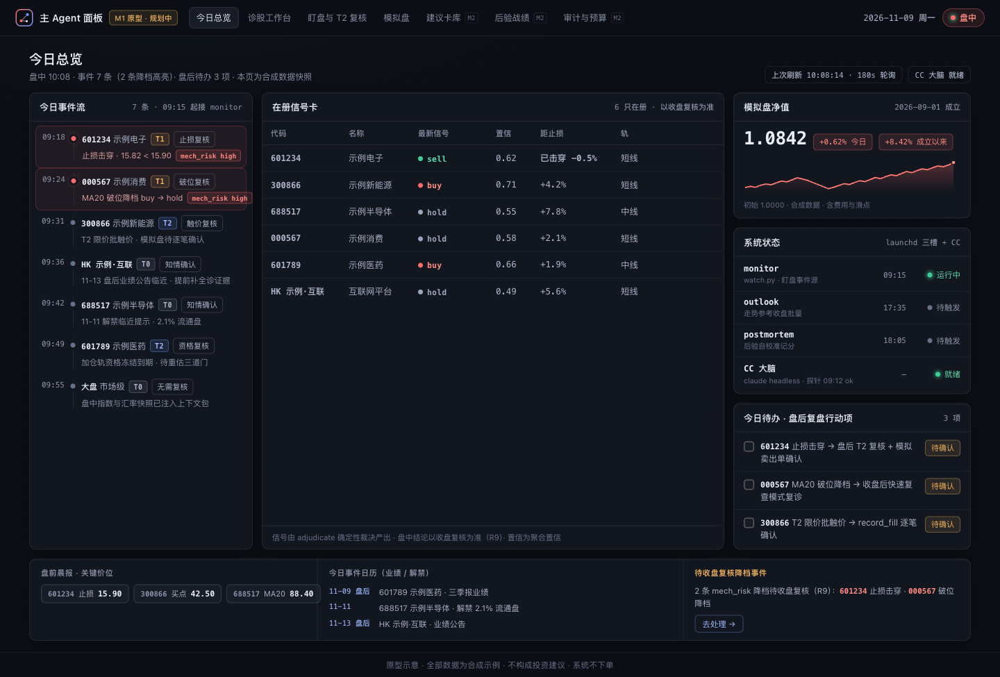
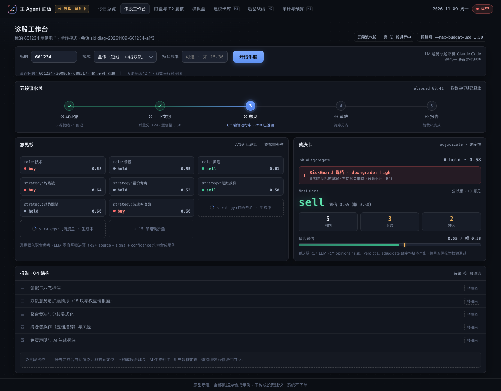
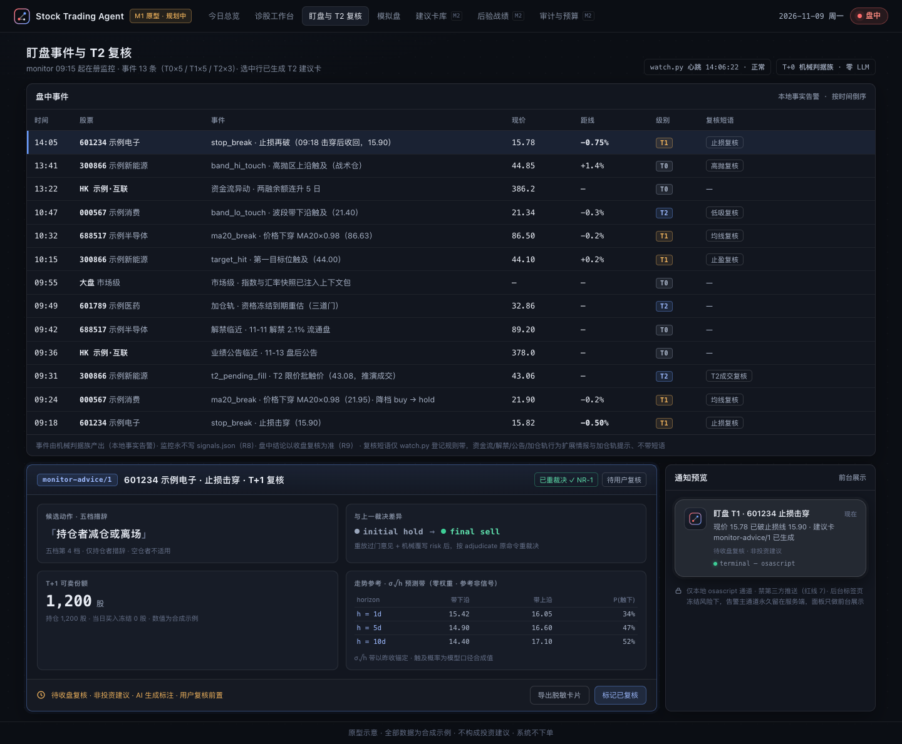
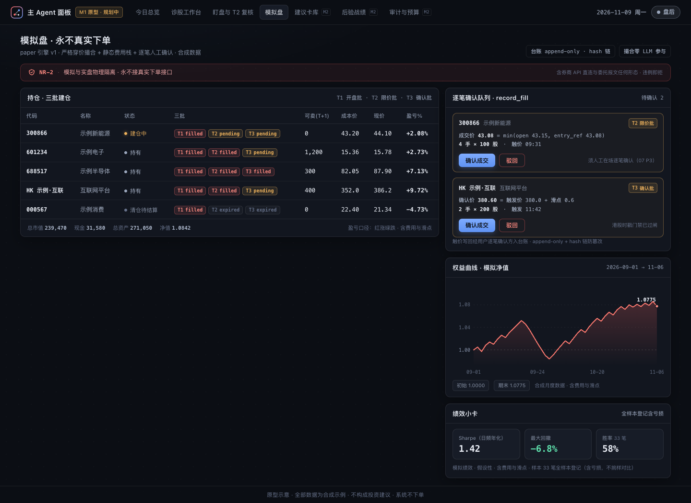

# 主 Agent（Claude Code 唯一大脑）产品与技术方案

日期：2026-11-06 · 状态：待审批 · 本方案及全部产物仅供学习研究，不构成投资建议

**前置说明**：本方案基于 [main-agent.md](main-agent.md) 调研报告（646 条 findings、159-agent 三段流水线产出）收敛。四项用户裁定为不可复议前提：①技术主线 Python + headless CLI 子进程（Agent SDK 对照）；②M1 即本地 Web UI 起步；③模拟盘口径盘中限价+滑点（永不真实下单）；④成果沉淀本仓。方案比选：三候选（A FastAPI 单体面板 / B 编排守护与只读面板分体 / C Tauri 桌面壳+sidecar）×三 lens（工程成本/红线合规/产品价值）确定性合分 A 39 / B 36 / C 30——**以 A 为骨架**（工程最简、单进程最短路径），**嫁接 B 的合规架构与产品增量**（显式红线编号锚定、写权限归属纪律、hash 链台账、T0/T1/T2 事件梯完整接线、模拟盘 M1 即落地 v1、面板崩不连坐盯盘记账的结构保证）**与 C 的边界纪律**（NR 红线最严形态、浏览器 tab 永为完整后备、Tauri 壳留 M2 门口评审）；评审对 A 的三条批评（红线无编号锚定、Web 攻击面与写权限同体、台账无防篡改）在合成中全部修复。架构图见 [docs/diagrams/main-agent/](../diagrams/main-agent/)。

## 上篇 产品方案

### 1 定位、目标用户与非目标

一句话定位：在 vibe-stock 确定性底座之上，以本机 Claude Code 为唯一 LLM 大脑的单用户「诊股·盯盘·操作策略·模拟盘」主 Agent——它是编排者与会话大脑，不是新的信号源（五段流水线 LLM 唯一必经段零改动）。主 persona：A 股+港股中线（1–6 月）个人投资者，实盘与模拟组合并存，纪律为盘前盘后复盘+行动项、盯盘事件带候选操作、交易必须人工确认、不追高频。非目标（显式）：高频/日内、任何形式的自动下单、多用户服务化、移动端云推送（红线 7 延伸，离机触达按「面板常驻拉取式主动查看」设计并明示锁屏不保证送达（I-63/I-68，未核验推导））。

### 2 四大能力域与复用映射

| 能力域 | 既有复用（零改动） | 净新增 |
| :--- | :--- | :--- |
| 诊股 | 五段流水线全链、addon 三道门（10）、战术仓读出（11）、走势参考（09） | 意图路由表、CCClient 会话编排、面板诊股工作台、decision log |
| 盯盘 | watch.py T0 事件（已实施）、T1/T2 规约预留位（07）、launchd monitor 槽、收盘复核 | T1 自动刷新接线（零 LLM）、T2 建议卡编排、面板事件页与复核入口 |
| 操作策略 | signals/ledger 投影、04 五档、outlook 日表、07 操作复核节、postmortem 槽 | 盘前晨报与盘后复盘行动项卡（「复核」措辞+确认状态） |
| 模拟盘 | 06 三段建仓三价、sim-portfolio.json P3 schema、t2_pending_fill 事件源 | paper 引擎、record_fill 逐笔确认流、权益曲线 |

复用度结论：诊股/盯盘/策略三域复用面 ≥80%，净新增集中在主 Agent 编排层与模拟盘引擎。竞品功能事实多靠横评拼图（官方信源占比 1/11，A-22），功能对标按降权口径使用。

四能力域的产品形态各以一张高保真原型呈现（自包含单文件 HTML + 整页 PNG，`docs/prototypes/main-agent/`，1440px 视口；数据全部合成：A 股用合成代码与名称、港股以「HK 示例」文字标识，与用户真实持仓零配对；每页页脚固定「原型示意 · 全部数据为合成示例，不构成投资建议，系统不下单」；视觉基调暗色量化终端风、A 股红涨绿跌、表格固定列宽单行省略；迭代只需改对应 HTML 后按同口径重截图，无构建链依赖）。



图 2-1 今日总览（能力域全景入口，盘中态）：launchd 三槽状态条、在册事件流、在跑 CC 会话与预算水位、待确认待办。

今日总览是四能力域的日常入口，关键设计有四：三槽状态条把 launchd 既有调度（monitor 09:15 / outlook 17:35 / postmortem 18:05）原样示出，「并存收编不替代」直接可见；事件流按 T0/T1/T2 事件梯分色分级，机械事件（零 LLM）与需人确认的事件（T2 建议、record_fill）视觉分流；在跑会话卡实时展示 CC 会话用量与预算水位，成本可见性是支柱③本地审计线的面板投影（NR-4 预算闸的前台呈现）；右侧待办把「止损击穿待盘后复核」「模拟卖出待逐笔确认」收口为当日行动项，与 §3 M2 的盘前晨报/盘后复盘行动项卡同构。



图 2-2 诊股工作台（诊股域）：五段流水线进度、双轨意见板、裁决卡（RiskGuard 降档链）与报告渲染位。

诊股工作台把五段流水线做成可观测过程而非黑箱结果，对应支柱①可解释与支柱④确定性安全壳：流水线五节点逐步点亮（图示截取第 ⑤ 段报告渲染中，①–④ 已完成），第 ③ 段意见生成期间意见板逐卡以「生成中」占位卡展示十策略双轨意见的返回进度（LLM 只产意见的面板化呈现）；裁决卡完整披露 initial 聚合→RiskGuard 降档→final signal 的裁决链与同向/分歧/冲突三计数，用户能看到「为什么从 hold 0.58 降为 sell」；报告区按 04 规约结构渲染并保留免责段占位；会话头部钉 `--session-id` 与预算标签，单次诊股的成本与归档可回溯。



图 2-3 盯盘事件与 T2 复核（盯盘+操作策略域）：事件表（复核短语列）+ T2 建议卡 monitor-advice/1 + 本地通知预览。

盯盘页承接 07 规约的事件语义并在其上叠 T2 决策闭环：事件表每行带「××复核」级短语（措辞限定「复核」、禁指令词，R7 只提示不执行），头部标注 watch.py 心跳与「零 LLM」标识，盯盘轮询本身不花模型钱的机制卖点直接可读；T2 建议卡按 monitor-advice/1 契约呈现候选动作、T+1 可卖份额、与上一裁决差异、σ√h 预测带四块——其中「与上一裁决差异」块是 NR-1 的用户可见面：建议卡必经原命令重裁决，差异由裁决器产出而非模型口述；本地通知预览呼应「告警主通道留在服务端、面板只做前台展示」的红线 7 落点。



图 2-4 模拟盘（模拟盘域）：NR-2 永不接真实下单横幅、三批建仓持仓表、record_fill 逐笔确认队列与权益曲线。

模拟盘页把 NR-2 做成常驻横幅而非设置项：「模拟盘永不接真实下单接口，与实盘物理隔离」钉在页面第一视觉层级；持仓表以 T1/T2/T3 徽章呈现三批建仓态（开盘批/限价批/确认批），可卖列显式带 T+1 口径；逐笔确认队列是 record_fill 闭环的前台：触价只写待确认记录，用户确认后才记账，无人工确认不落账；权益曲线与绩效小卡标注「含费用与滑点」，与 §12 严格穿价+静态费用栈的撮合口径互为表里，对齐差异化主张中「不虚增胜率」的诚实模拟定位。

### 3 MVP 分期（对齐 07 规约 M3 预算闸；launchd 三槽并存收编不替代）

- **M1 面板起步·人在环**：FastAPI 单体（StaticFiles 同进程托管前端+htmx 轮询起步，NiceGUI 可作免构建链加速项）+ CCClient 主通道 + 断言器 + 意图路由 + `agent/` 状态与审计 + **paper 引擎 v1**（严格穿价撮合+静态费用栈+逐笔人工确认；T+1/涨跌停三态/公司行动留 M2）+ T1 自动刷新接线（零 LLM，消费 monitor 台账）；全部 CC 会话人在环（面板/对话手动触发，含 T2 手动入口「盯盘复核 <code>」）；面板由第四个 LaunchAgent 守护（KeepAlive{Crashed}）。
- **M2 决策闭环**：T2 建议卡全链（重放意见→机械覆写 risk→原命令重裁决→monitor-advice/1 卡）+ paper 引擎全量（T+1、涨跌停三态、停牌、公司行动、分档红利税）+ 盘前晨报/盘后复盘行动项卡 + decision log 以 `agent:` 前缀接入 18:05 postmortem 槽独立画像记分 + SSE 实时流（sse-starlette+watchfiles）+ Tauri 桌面壳门口评审（以 M1 使用数据判定，不过则退化 pywebview 轻窗，I-41）。
- **M3 无人值守（默认关）**：watch.py P2 会话接管（exit 2 形态）触发自动 T2；预算双闸+硬性次数闸齐上、用户显式开启方生效——对齐 07 规约「无人值守自动拉起 LLM 属 M3 且须显式预算闸」（TdxClaw 默认 30 分钟心跳持续耗积分的教训，A-68）；评估原生 `--bg` 会话族替代自管保活（D-63）与 Agent SDK 对照实验（cli_path 钉同一二进制、对齐 system prompt 与 settings，D-16/D-17）。

launchd 关系：三份 plist（monitor 09:15 / outlook 17:35 / postmortem 18:05）职责原样保留，主 Agent 只消费其台账产物与承接 07 预留升级位，不引第二套调度器（I-36/I-11）。

### 4 竞品借鉴与拒绝表

借鉴：问财 SkillHub 三件套与老虎 tigeropen-skill「装进 ~/.claude/skills/」验证 Skill 分发范式（仅取数据/模拟面，交易面禁用，A-02/A-25）；moomoo AI Agent Toolkit「智能交易默认模拟盘、实盘需二次确认」的默认模拟面与本架构同构（券商级先例；其交易/实盘面不在借鉴范围，NR-2）（A-24）；Holly「每夜回测竞争入选」与 postmortem 升降档同构、信号字段完整性（entry/stop/target/hold）对齐建议卡（B-01）；TrendSpider Script Manager「一套规则 schema 驱动警报/扫描/回测三端」对齐策略 YAML 单一事实源（B-23）；Tickeron「目标价+置信档+成功概率」三件套对齐置信帽+后验记分（B-57）；AI涨乐三工作区与牛牛AI 早晚报的盘前/盘中/盘后信息架构与「无信息即弃权」（A-17/A-26）；Danelfin AI Score Audit 的 look-ahead 审计面板对齐后验全样本登记（B-15，未核验：官网 403，方向线索非判据）。拒绝：执行侧全部（webhook 下单/SignalStack 路由/自然语言下单，B-24/B-71/B-51）；微信/云推送通道（红线 7）；零滑点零费用模拟（B-32/E-58）；回溯重算战绩（B-14）；指标阈值+异动提醒的止步形态（做「事件→复核动作」语义链，A-36/A-14）；AI 炒股话术族（A-59/A-63）。

### 5 差异化主张（四支柱）

①**可解释**：每条意见 rationale 引证据块数值、聚合确定性、分歧显式化——vs 问财/妙想黑箱（A-01/A-11）；②**后验校准公开**：T+N 记分台账、绩效因子升降档、预测带校准表 + 主 Agent decision log 同纪律（`agent:` 前缀）——竞品无用户可见自校准闭环，Danelfin 审计面板是方向线索（B-15，未核验：官网 403，非判据）；③**本地 SSOT + LLM 零直连审计线**：全状态在 `~/.vibe-stock/` 可审计、所有 LLM 调用单通道经 Claude Code、stream-json 归档+decision log 双轨——vs SaaS 数据外流（F-36/F-38）；④**确定性安全壳**：RiskGuard 只降不升、门禁只收严、交易人工确认、paper 永不接真实下单、断言器硬门——vs「AI 帮你炒股」执行风险叙事（C-36/G-31）。对照锚：成本结构（订阅复用；单股诊股裸 token 成本美分级（$0.002–0.09，H-21），叠加每次 spawn 固定开销（约 $0.20，F-59/H-41）后全成本约 $0.3–0.65/次，单只每交易日诊一次月约 $6.5–14 API 等价量级、随实盘只数线性放大（推导估算）；vs 竞品 AI 档 $178–254/月或 3888 元/月档，H-09/A-55）不列主主张、避免定价对标失真。

### 6 红线继承与新增红线

继承 13 条包层红线（逐条编号锚定，出处 AGENTS.md/SKILL.md/06/07/09/10/11）：R1 不构成投资建议、不下单不改单不撤单、不保证收益；R2 敏感信息零落盘且零接触（不读写真实账户、密钥、Cookie，取数只用公开行情接口；成本/数量/可反推派生量不进任何落盘产物）；R3 裁决链不可跳过改写（LLM 只产 opinions/risk，终判一律 verdict.json）；R4 汇率不进裁决；R5 RiskGuard 只降不升（含盘中重裁决三重锚）；R6 门禁判据只收严；R7 监控只提示不执行、禁第三方推送通道；R8 监控永不写 signals.json；R9 盘中结论以收盘复核为准；R10 批量取数串行、中 tier 不登记；R11 走势参考零权重；R12 加仓轨不投方向票；R13 战术仓用户裁量层不入仓。

新增红线族（NR，随本方案审批生效）：**NR-1** 建议卡必经 adjudicate 原命令重裁决（重放过门意见+机械覆写 risk、LLM 只补 rationale），违例拒出卡降级纯事实通报；**NR-2** paper 引擎永不接真实下单接口——含券商 API 直连与委托报文任何形态（最严形态，采候选 C），模拟与实盘物理隔离对齐 Alpaca 双端点先例（G-31）；**NR-3** CC 会话产物一律过 `--json-schema`+本地红线断言器（draft-07 复验、signal 五词枚举、免责段在场、敏感字段零落盘扫描）方可落盘，违例拒落盘；**NR-4** CC 调用必带 `--max-budget-usd` 与预算/轮次字段（人在环与无人值守同规）；无人值守（L2）另必带工具白名单+`--permission-prompts none`，无闸即拒起（07 M3 预算闸的工程化，判据只收严）；**NR-5** `agent/` 与全部面板产物零敏感参数，落盘前断言器扫描（沿 11 门禁先例）。

### 7 合规免责与审计承诺

单用户本机自用、永不对外、永不收费——同时避开证券投资咨询许可（暂行办法第 2 条「有偿+为客户」不落入，G-03）、生成式 AI 备案（未向公众提供不适用，G-02）与 PIPL 义务（第 72 条个人家庭事务豁免，G-30）。措辞纪律：只描述真实机制——「LLM 只产意见、聚合与信号为确定性脚本」写成公开分工说明，即满足反 AI washing「说做了什么就真做什么」标尺（G-11/B-48）；Anthropic AUP 把个性化买卖建议列为 High-risk AI Recommendation、须合格人员（即用户本人）实质复核并告知 AI 参与——报告与建议卡全量带 AI 生成标注+用户复核前置（G-24）。免责四件套进全部产物：非投顾定位+不构成投资建议+模拟绩效假设性+AI 生成标注与复核前置（G-19/G-23）；补齐竞品普遍缺失的 AI 归责句（G-23）。审计承诺：decision log（hash 链防篡改，A-65 先例）+ stream-json 归档 + `--session-id` 关联三件套；战绩全样本登记含亏损、禁挑样对比（G-12）；保本/胜率承诺/晒单战绩入文案黑名单（A-59/A-63）。

## 下篇 技术方案

### 8 双层架构总览


图 8-1 双层架构四层组件图：确定性层零改动可独活，LLM 零直写裁决面为分层铁律。

四层：确定性层（launchd 三槽+scripts 六件+batch，零改动、可独活——CC 不可达时盯盘/台账/后验全部照常：launchd 三槽直接调起脚本、不经主 Agent 进程，此为结构保证）；主 Agent 层（FastAPI 单体：面板/路由/队列/CCClient/断言器/paper 引擎）；CC 大脑层（claude headless 子进程，唯一 LLM 通道）；状态层（既有 SSOT + `agent/` 唯一新写区）。分层铁律（图上醒目标注）：**LLM 零直写裁决面**——signals/ledger 的写者永远是既有确定性脚本（R3/R8 的写权限归属实现：单进程内以模块级写者纪律+断言器扫描落地，M3 无人值守开启时评估升级为 B 候选的进程级分离）。单进程单点风险处置：第四 LaunchAgent KeepAlive{Crashed} 自动重启+台账幂等断点重放+显式 AbandonProcessGroup 防守护重启连杀在跑 CC 子进程（I-57/I-59）。

### 9 Claude Code 集成通道选型

三通道矩阵结论（ch08 实测）：headless CLI=大脑主通道（全旗标本机 2.1.310 实测）；Agent SDK=对照通道（Python 版自动寻本机 claude 并继承订阅 OAuth，但捆绑 CLI 版本漂移，对照实验须 cli_path 钉同一二进制+显式对齐 system prompt 与 settings，D-14/D-16/D-17）；mcp serve=拒入大脑链路（工具桥非大脑、约 2.6 万 token 固定开销、未文档化+EOF 孤儿进程 open issue，F-01/D-22/D-24/D-25）。认证分叉治理：编排环境显式 unset ANTHROPIC_API_KEY（存在即静默脱离订阅计费，F-31）、启动探针认证态；`--bare` 只认 API key 不读订阅 OAuth、官方预告将成 -p 默认——列头号升级观察项（D-04/F-29）。

CCClient 契约（采 B 候选签名级细化）：

```python
@dataclass(frozen=True)
class CCRequest:
    task_id: str; session_uuid: str        # UUIDv5(ns, f"{date}:{code}:{kind}")（F-60）
    prompt: str | Path                     # Skill 入口「/vibe-stock 600519」形态（F-49）
    schema: dict | None                    # draft-07 扁平子集，意见段必带（F-11/F-12/F-16）
    budget_usd: float; max_turns: int      # 每任务必填（NR-4）
    allowed_tools: tuple[str, ...]; permission_mode: str = "dontAsk"  # F-24
    mcp: str = "strict-empty"              # --strict-mcp-config+空 --mcp-config（D-53：429k→2.8k tokens）
    timeout_s: int = 900; autocompact: str | None = None

class CCClient(Protocol):
    def spawn_once(self, req: CCRequest) -> CCResult: ...
    def resume(self, session_id: str, req: CCRequest) -> CCResult: ...  # 旗标全量重传（D-32）
    def probe(self) -> ProbeReport: ...    # --version+认证态+init.capabilities（F-10/F-31）

@dataclass
class CCResult:
    exit_code: int; envelope: dict | None       # subtype/total_cost_usd/usage/session_id
    structured_output: dict | None; result_line_present: bool
    transcript_path: Path; usage_tokens: dict
```

硬约束：子进程长期持引用防 GC 误杀+`asyncio.wait_for` 超时（I-37）；SIGTERM=143 弃轮、收轮用 SIGINT（D-01）；续话一律 `--resume` 禁 `--continue`（D-37/D-76）；迭代 system prompt 须 `--system-prompt-snapshot off`（F-43）；高频 spawn 固定成本约 $0.20/次（1h cache 写 49k tokens），同日多任务评估 resume 续连摊薄（F-59/D-36）。

### 10 主 Agent Loop 事件驱动设计


图 10-1 Loop 六段时序图：三触发源→意图路由→一次性 CC 会话→断言器→落盘→后验反馈环（含 M1/M2/M3 泳道与降级路径）。

六段：①**触发源**三类（面板手动/launchd 槽完成事件经 watchfiles 监听台账/M3 盯盘事件自动接管），统一带 dedup_key 事件信封；入队前查 watch.lock 与取数串行锁，17:30–18:10 禁跑 report。②**意图路由**：YAML 确定性路由表（kind→任务模板：全诊/快速复查/T2 复核/批量波次/paper 确认/晨报复盘），零 LLM——routing 积木（C-76）；T0→本地通知、T1→diagnose prepare 两类零 LLM 分派。③**CC 会话**：每任务一次性 `claude -p` 短会话、fresh context（多轮长会话平均掉 39%，C-88）；`--session-id` 按日期+标的+任务派生 UUID；prompt 以 `/vibe-stock <code>` 拉起 Skill（F-49）。④**确定性后处理断言器**（落盘前置门，NR-3）：三段完成判据=退出码+result 信封+result 行存在（exit 0 不代表业务成功，D-01/D-05/D-06）；success 而 structured_output 缺失视为失败（strict 静默回退不可自证，F-14/F-15）；本地 draft-07 复验+红线断言族。⑤**落盘**：原子 os.replace 写 `agent/`，decision log 追加（hash 链）；建议卡链=重放过门 opinions→机械覆写 risk.json→adjudicate 原命令重裁决（NR-1）。⑥**后验反馈环**：decision log 以 `agent:` 前缀进 18:05 postmortem 槽记分；经验学习限定结算后+按标的限量 2–4 句短反思，盘中重诊不回灌近期对错结论（C-04/C-64/C-61）。

### 11 状态扩展设计


图 11-1 状态扩展数据流图：既有 SSOT 与新增 `agent/` 唯一新写区的读写矩阵。

`~/.vibe-stock/agent/` 布局与读写矩阵：

| 路径 | 内容 | 主 Agent | 面板 | launchd 槽 |
| :--- | :--- | :--- | :--- | :--- |
| agent/queue.json | 任务队列+幂等键+状态机（WAL 语义） | 写 | 读+提交命令 | — |
| agent/sessions.json | 会话登记（uuid/转录路径/用量/成本） | 写 | 读 | — |
| agent/decisions.jsonl | decision log（`agent:` 前缀，hash 链防篡改） | 追加写 | 读 | postmortem 消费 |
| agent/audit/<date>/ | stream-json 原始归档（官方转录默认 30 天清理，F-38） | 写 | 读 | — |
| agent/budget.json | token+等效美元台账（订阅轨双口径，F-34） | 写 | 读写 | — |

sim-portfolio.json 留 `~/.vibe-stock/` 根（07 P3 schema 原样，写者=paper 引擎）；既有 SSOT 对主 Agent 全部只读或既有写者不变（R3/R8 的状态层实现）。锁纪律：agent/daemon.lock 单实例；尊重 fetch_state.lock 取数串行与 watch.lock。

### 12 模拟盘引擎设计

本节全程受 **NR-2** 约束：永不接真实下单接口——含券商 API 直连与委托报文任何形态，模拟与实盘物理隔离；本节是未来 references/13-paper.md 的母体，红线句随拆分原样携带。纯确定性模块、零 LLM 参与。


图 12-1 模拟盘生命周期：allocation 导入→三批限价建仓（T1/T2/T3）→holding→closed（任一批成交即进 holding，所有存在的批均 expired 才判建仓失败（拆出 T3 批的多手仓位因 T3 补足不会因到期而失败；成交请求被驳回或未确认时批保持 pending，不产生状态迁移），口径以 [07](../../references/07-monitor.md) sim 组合 SSOT 为准），成交写回经用户逐笔确认环。**撮合**（ch09 基线）：限价单严格穿价成交（买入单 low<limit、价=min(open,limit)；卖出单镜像），止损单 max/min(open,stop)±滑点，同 bar 多触发按止损先发生的悲观序（触价口径可令年化摆动 ±240bps，E-05）；tick 穿越旋钮默认 ≥1 tick（E-04）。**三批建仓**（06 Stage D + 07 P3 schema）：T1 开盘批（次日竞价入口，E-52/E-53；跳空 >+2% 转限价、5 日 GTC，口径见 [06](../../references/06-batch-scan.md) Stage D）/T2 限价批（触价写回经用户逐笔确认、成交价 min(open,entry_ref)）/T3 确认批。**滑点静态表**：A 股固定 5–10bp 起步+半价差与最小 tick 自行标定（散户小单冲击重要性仅 3.63%，E-18；不沿用任何引擎默认值——引擎默认域证据 E-73/E-74 未核验、仅作线索）；港股按最小价位分档（0.25–10 港元档 0.005 港元，仙股 1 tick≈167bp，E-55）；量相依冲击（Almgren 3/5 幂律、A 股指数 0.7）留大额/低流动性升级位（E-16/E-17）。**费用栈**分段常量：A 股卖出印花税 5bp+过户费 0.1bp 双边+佣金最低 5 元留用户配置位；港股印花税 10bp 双边向上取整 1 港元+交易费 0.00565%/边+SFC 0.0027%+AFRC 0.00015%+CCASS 0.002%（min 2 max 100 港元）（E-10~E-15）。**A 股本地化**：T+1（可卖=持仓−冻结−当日买入、日切清零，E-42/E-48）、100 股手数、涨跌停三态（一字板不可成交、涨停价最小变动单位取整）、停牌三规则、公司行动先送转后分红+分档红利税（E-09/E-26/E-41/E-43）。**港股标的门禁**：时戳新鲜度未过闸一律回落收盘复核成交（E-25；E-76/E-77 未核验，重探定谳前保守处置）。**纪律**：成分精选只做前向模拟不做历史回溯收益宣称（E-22/E-23）；逐笔成交 append-only+hash 链台账（A-65）；口径严于 Alpaca paper（不模拟滑点分红）与 TradingView paper（零费用）基线（E-56/E-58）。

### 13 安全与预算

权限分级：L0 纯脚本（零 CC）/ L1 人在环 CC（面板触发）/ L2 无人值守 CC（M3、默认关）。CC 会话标准件：`--permission-mode dontAsk`+精确 `--allowedTools`+`--permission-prompts none`（拒绝记入 permission_denials 审计流水，F-24/F-28）；PreToolUse hook deny 为裁决链不可绕过的宿主侧抓手、零例外红线交 harness 强制（F-56/C-81）；paper 逐笔确认走 -p 第四决策值 defer 挂起等人工（F-57）。预算双闸+硬顶：内闸=每次 spawn 必带 `--max-budget-usd`（真实上限=cap+最贵单次调用，实测 $1 顶停于 $1.38，F-17/F-18）；外闸=发送前预检（任务数×单次估算 vs 日/月 USD 信封）+硬性次数闸；订阅轨按 token 数+等效美元双口径记账（F-19/F-34）；订阅登录态下程序化用量（`claude -p`/Agent SDK）仍计入订阅 5 小时/周额度窗口，独立 credit 池拆分已被官方暂缓（Anthropic. Use the Claude Agent SDK with your Claude plan, 2026-11-06 复核, https://support.claude.com/en/articles/15036540-use-the-claude-agent-sdk-with-your-claude-plan；暂缓非取消，列政策观察项）。预算数值按计费形态分档（D2）：形态由 `probe()` 认证态机判（订阅 OAuth 且无 ANTHROPIC_API_KEY，F-31），订阅形态数值放开、真实上限是额度窗口；若开启 usage credits 且未设支出上限，额度耗尽后会按量计费（官方 costs 页；D-44 另载中途静默切换且 /cost 停止累计），探针认证态一旦变化即按 API 档默认值收紧。面板安全：绑 127.0.0.1 之上加 TrustedHostMiddleware 白名单防 DNS rebinding（I-46/I-47）；数据面单文件/JSON 原子写，不引数据库。

### 14 可靠性与降级

锁纪律全继承（取数串行/watch.lock/17:30–18:10 禁跑窗）；同机交互会话与多槽并发错峰防 OAuth refresh token 竞争（D-71）。降级：CC 不可达→面板转只读+事件照落台账+「待会话复核」通报（设计内形态非故障）；断言违例→拒落盘+纯事实通报（NR-1/NR-3）；港股时戳未过闸→收盘复核成交。幂等：dedup_key+幂等键+UUIDv5 会话身份，崩溃重启按台账断点重放（adjudicate 确定性保证重放安全）。版本治理：`claude install` 精确版本+DISABLE_AUTOUPDATER=1 钉死；升级门禁三件套=--version 健康探针+--help 旗标快照 diff+init.capabilities 特性探测+CHANGELOG 扫描（F-44/F-10/F-37）；从 2.1.310 升级直接跳 2.1.318（避开 2.1.314–2.1.317 回归窗，D-76）；进程泄漏巡检+超时杀进程树+watchdog 轮询 waitingFor 兜底权限挂起（D-08/D-72）。launchd 联动：uvicorn 优雅关停窗口小于 ExitTimeOut；AbandonProcessGroup 显式裁定为保留在跑 CC 会话（I-57/I-59）；WatchPaths 不用（race-prone，I-52）、caffeinate -i 交易时段防睡死+收盘兜底（I-50）。

### 15 可观测、评估与后验闭环

decision log 指标族：意图路由命中率（确定性 vs 兜底）、三段判据失败率、断言违例率（按断言类型分桶）、预算/日曲线、会话成本分布（OTEL token/cost 按 skill 归因，D-69）、建议卡 T+1 复核命中率（`agent:` 前缀画像，07 monitor: 前缀同构）。后验闭环：decision log 进 18:05 槽独立画像记分；披露形态复用 outlook calibration「预测 vs 实际」分桶表；样本 <30 只观察不记分、战绩短于 MinTRL 只标「样本不足」（midterm 纪律）。审计：decisions.jsonl（hash 链）+audit/ stream-json+sessions.json 三件套互查；敏感 run 可 `--no-session-persistence` 与编排自记分层（F-42）。

### 16 本地 Web 面板

形态钉死「浏览器 tab 直连本地 FastAPI」：StaticFiles 同进程托管前端、单 worker 裸跑 uvicorn（I-03/I-34/I-61），NiceGUI 纯 Python 起步免前端构建链（I-40）、独立窗口留 pywebview（I-41）、桌面壳不进 M1（I-01/I-02）。页面七页：①今日总览（三槽状态+事件流+在跑会话）②诊股工作台（输入码→五段→渲染报告）③盯盘事件与 T2 复核（事件给候选动作+复核短语）④模拟盘（三批建仓状态/逐笔确认表/权益曲线）⑤建议卡库 ⑥后验战绩（全样本含亏损、模拟绩效标注假设性）⑦审计与预算。实时通道：htmx 轮询起步（180s tick 近实时足够，I-23）→按需 SSE（sse-starlette+watchfiles 盯台账目录，I-27/I-45）；WebSocket 不进方案（I-26）；告警主通道永久留在服务端 osascript（后台标签页冻结+程序化通知收紧，I-48/I-51），面板只做前台展示。

页面①—④的高保真原型（合成数据）已在上篇 §2 借图展开（图 2-1～图 2-4），此处不重复嵌图。

### 17 实施规约落位预案

本方案获批即视为以下规约骨架获批，实施期首个 PR 建 `references/12-orchestration.md`（编号续排）并同步 AGENTS 目录速查/SKILL 判表：①定位与边界（LLM 唯一通道、写权限归属、并存收编）；②CCClient 通道契约（§9 签名级）；③主 Loop 六段规约（§10，含 NR-1/NR-3 断言器判据族）；④状态扩展写拓扑（§11 表）；⑤预算闸与降级规约（§13/§14，NR-4 判据只收严）；⑥门禁预案：新增 `agent/` 编排件 selftest（断言器判据+路由表+撮合口径纯函数回归，判据只收严），六件 scripts selftest 口径不变、盯盘两件（rules.py/watch.py）旁路门禁义务随 batch/monitor 联动改动同规。paper 引擎规约体量大时 M2 拆 `references/13-paper.md`；T2 建议卡规约细节以 07 已钉死契约为准不另立。

### 18 决策点汇总与推荐默认

已裁定（不再议）：Python+CLI 主线 / Web UI 起步 / 限价+滑点口径 / 本仓沉淀。待批决策点：

| # | 决策点 | 推荐默认 | 理由 |
| :--- | :--- | :--- | :--- |
| D1 | 产品命名 | 方案 PR 由用户裁定（候选：vibe-pilot / vs-agent；不得含「Claude Code」字样，Anthropic 品牌约束） | 命名属用户裁量 |
| D2 | M3 预算闸数值 | 按计费形态二选一（已裁定）：①**全部调用走订阅登录态（OAuth）→ 预算数值先完全放开**（`--max-budget-usd` 仍带高位哨兵值满足 NR-4，日/月 USD 信封不设闸、仅记账，硬性次数闸保留）；②**任一调用走 API Usage 计费 → 单会话 $1、日累计 $8、月 $100 量级**（占位 estimated：按含固定开销全成本 $0.3–0.65/次 × 实盘只数日诊推导，对照 §9 固定成本 $0.20/次与 Sidekick $0.35–0.49/条锚；单会话闸压到 $0.5 以内会让常规诊股频繁触顶） | 机制已钉死（NR-4）、数值依计费形态：订阅登录态下 `claude -p` 仍计入订阅额度而非美元计费（官方帮助页，§13）；形态由 `probe()` 认证态机判，不凭配置自述 |
| D3 | AbandonProcessGroup | true（保留在跑 CC 会话，泄漏由巡检兜底） | 守护重启连杀子进程代价高于泄漏巡检成本（I-57/D-08） |
| D4 | Tauri 桌面壳 | M2 门口评审、默认不做（浏览器 tab+pywebview 已覆盖） | C 候选自认边际价值存疑（judge value 7） |
| D5 | watch.py exit 2 自动接管时点 | M3 与预算闸同批启用（07 坑位④协调问题届时裁定） | 对齐 07 规约预留 |
| D6 | Agent SDK 对照实验 | M2 随批量波次编排做一次受控对照（cli_path 钉同版本） | 通道结论的实证加固，D-16/D-17 |
| D7 | 滑点静态表数值 | A 股 10bp/港股按最小价位 1 tick 起步，标 estimated、以自家成交回报样本校准后固化 | 散户小单价差主导（E-18），无现成锚（E-73/E-75） |
| D8 | 港股时戳门禁重探 | M1 实施首周做 r_hk 时戳重探定谳（E-25 vs E-76 冲突），定谳前港股 T2 限价批一律收盘复核成交 | 港股标的存在盘中行情延迟，阻塞面明确 |

### 19 风险地图

| # | 风险 | 缓解 | 证据锚 |
| :--- | :--- | :--- | :--- |
| R-01 | 面板崩=编排停（单进程单点） | 第四 LaunchAgent 守护重启+台账幂等断点重放+AbandonProcessGroup | I-10/I-57 |
| R-02 | CC 进程泄漏拖垮整机 | 超时杀树+单实例锁+重启孤儿巡检+watchdog | D-08/D-72 |
| R-03 | CLI 版本回归/旗标漂移 | 钉版本+升级门禁三件套+versions/ 回滚；--bare 化头号观察项 | D-09/F-30/F-37/D-04 |
| R-04 | 预算越限（事后计价） | 双闸+硬次数闸+token 双口径记账+订阅额度窗口监控 | F-18/F-35 |
| R-05 | stream 截断/静默丢 result | 三段判据+转写对账+一次性进程+resume | D-05/D-06 |
| R-06 | OAuth 竞争/认证静默切换 | 多槽错峰+CC 串行化+认证态探针+unset API key | D-71/F-31 |
| R-07 | 模拟盘口径争议 | 口径公示（本章）+保守侧默认+旋钮留白+hash 链台账 | E-05/E-06/A-65 |
| R-08 | 港股延迟行情误成交 | 时戳门禁+保守惩罚+回落收盘复核 | E-25/E-76 |
| R-09 | 结构化输出静默回退/长输出截断 | 本地复验+小 schema 短输出+缺失视为失败 | F-14/F-16 |
| R-10 | 红线穿越（LLM 绕裁决链/敏感落盘） | 断言器硬门+PreToolUse deny+脱敏负断言 selftest+违例拒落盘 | F-56/C-81/NR-3 |
| R-11 | 合规话术越界/AI washing | 措辞只述真实机制+免责四件套+AI 归责句+文案黑名单 | G-11/G-24/A-59 |
| R-12 | launchd 退出连坐杀 CC 子进程 | AbandonProcessGroup+优雅关停窗<ExitTimeOut | I-57/I-59 |
| R-13 | 订阅权益单方变动（含已暂缓的程序化用量 credit 池拆分重启） | 双通道兜底（订阅 OAuth+API key）+成本双口径记账 | H-27/D-15（拆分已暂缓） |

*本方案仅供学习研究，不构成投资建议；系统不下单、不改单、不撤单、不保证收益。实施待用户审批后启动。*
